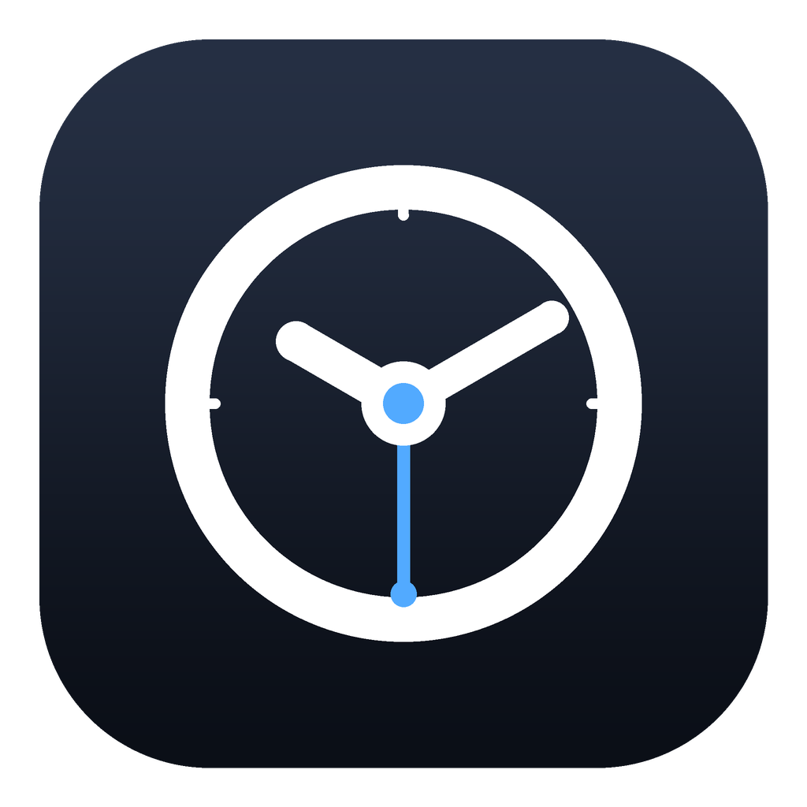

<p align="center">
  
</p>

<h1 align="center">DesktopClock</h1>

<p align="center">
  <a href="https://github.com/lisniuse/DesktopClock/actions/workflows/build.yml"></a>
  <a href="LICENSE"></a>
  
</p>

一个轻量的 Windows 桌面时钟：在屏幕右上角以「微软雅黑 + 白色文字 + 黑色阴影」显示当前时间、日期和星期，支持托盘菜单、编辑模式、置顶和开机启动。

## 功能

- 屏幕右上角透明悬浮显示，不占用任务栏，不抢焦点
- 时间 `HH:mm:ss` + 中国格式日期 `yyyy年M月d日 星期X`
- 微软雅黑字体，白色文字，黑色柔和阴影，随窗口大小自动缩放字号
- 托盘图标与右键菜单：
  - **编辑模式**：勾选后显示虚线边框与四角控制点
    - 拖动四角：自由缩放窗口，文字自动适应
    - 拖动文字区域：移动位置
    - 关闭编辑模式后鼠标点击穿透，不影响桌面/其他窗口操作
  - **置顶**：控制窗口是否始终位于其它窗口之上（默认开启）
  - **鼠标移上去消失**：勾选后鼠标移入时钟区域时淡出、移开后淡入；编辑模式下自动暂停，保证时钟始终可见
  - **开机启动**：写入/删除当前用户的启动项（无需管理员权限）
  - **退出**
- 位置、大小、置顶、鼠标悬停淡出状态自动保存，下次启动恢复
- 单实例运行：重复启动不会开第二个窗口，而是切换编辑模式
- 托盘图标双击也可切换编辑模式；编辑模式下右键窗口同样可以打开菜单

## 编译

需要 Visual Studio 2022（含「使用 C++ 的桌面开发」工作负载）和 Windows SDK。

```bat
build.bat
```

产物：`build\DesktopClock.exe`。

也可以使用 CMake（可选）：

```bat
cmake -S . -B build -G "Visual Studio 17 2022" -A x64
cmake --build build --config Release
```

## 使用

1. 运行 `build\DesktopClock.exe`，时钟出现在主屏右上角。
2. 右键（或双击）托盘图标打开菜单。
3. 勾选「编辑模式」，拖动四角和文字调整位置/大小，调整完再取消勾选。
4. 托盘图标可能位于任务栏的「隐藏的图标」溢出区中，可将其拖到任务栏常驻。

打开编辑模式的另一种方式：再次运行一次 exe（单实例机制会切换编辑模式）。
调试时也可以使用 `DesktopClock.exe --edit` 直接以编辑模式启动。

## 配置文件

```
%USERPROFILE%\.desktop-clock\config.ini
```

```ini
[window]
X=1857
Y=352
Width=242
Height=107
Topmost=1
HideOnHover=0
```

删除该文件后下次启动会回到默认位置和大小。

开机启动项位于注册表：

```
HKEY_CURRENT_USER\Software\Microsoft\Windows\CurrentVersion\Run
DesktopClock = "<exe 完整路径>"
```

## 目录结构

```
DesktopClock/
├─ assets/
│  ├─ logo.svg            # 矢量 Logo
│  ├─ logo.png            # 1024×1024 Logo
│  └─ logo-256.png
├─ res/
│  ├─ app.rc
│  └─ icon.ico            # exe 图标 + 托盘图标（多尺寸）
├─ scripts/
│  └─ make_icon.py        # 重新生成 Logo / 图标
├─ src/
│  ├─ main.cpp            # 入口、单实例、GDI+ 初始化
│  ├─ clock_window.h/.cpp # 分层窗口、渲染、托盘、拖拽编辑
│  ├─ config.h/.cpp       # 配置读写、开机启动项
│  └─ resource.h
├─ .github/workflows/     # GitHub Actions 自动构建
├─ build.bat              # MSVC 一键编译
├─ CMakeLists.txt         # 可选的 CMake 工程
├─ CONTRIBUTING.md
├─ CHANGELOG.md
└─ LICENSE
```

## 说明

- 目前仅支持中国格式日期与星期，字体固定为微软雅黑（缺失时依次回退到 Microsoft YaHei UI / Segoe UI / Arial）。
- 窗口采用 `UpdateLayeredWindow` + 32 位 ARGB 画布绘制，文字抗锯齿，背景完全透明。
- DPI：程序按系统 DPI 缩放默认尺寸；手动调整后的像素尺寸会被保存。
- Logo 与应用图标由 `scripts/make_icon.py` 生成（需要 Pillow）；修改设计后执行 `python scripts/make_icon.py` 即可重新生成 `assets/` 与 `res/icon.ico`。

## 贡献

欢迎提交 Issue 与 Pull Request，详见 [CONTRIBUTING.md](CONTRIBUTING.md)。

## 许可证

[MIT](LICENSE) © 2026 lisniuse
